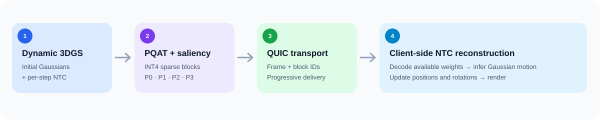

# Q3DGStream

### Saliency-Driven Adaptive Streaming of Dynamic 3D Gaussian Splatting over QUIC

[](https://www.python.org/)
[](docs/linux.md)
[](docs/linux.md)
[](docs/FORMATS.md)
[](LICENSE)

**Q3DGStream** is a research framework for transmitting dynamic 3D Gaussian Splatting scenes using **compressed Neural Transformation Caches (NTCs)**. It combines block pruning and quantization-aware training (PQAT), multi-view saliency-aware weight ordering, and progressive QUIC delivery.



The initial 3D scene is transferred once. Each animation update then carries a compact NTC whose weight blocks are organized into four saliency priorities. The receiver reconstructs the available weights, executes the NTC and renders updated Gaussians.

> **Project status:** The original TCP renderer, standalone QNP01 decoder and offline analysis tools are in this repository. A 30-update QUIC pilot has been tested with a locally patched receiver; the exact local viewer patches are still being incorporated. Experimental QUIC scripts require these receiver hooks, as detailed in [QUIC setup](docs/QUIC.md). Adaptive network scheduling and end-to-end saliency QoE are active research targets.

## Quick start

**No GPU required:** Clone the project and inspect an example quantized NTC priority stage:

```bash
git clone https://github.com/publioelon/3DGS-QuaNTiC-Demo.git
cd 3DGS-QuaNTiC-Demo
python3 q3dgstream.py demo
python3 q3dgstream.py test
```

**Ubuntu + NVIDIA:** Install the CUDA environment and Flame Steak scene using the existing installers:

```bash
./scripts/setup_linux_venv.sh
source ~/venvs/qntcstream/bin/activate
./scripts/download_flame_steak.sh
python3 q3dgstream.py doctor
```

For the existing TCP receiver and NTC playback, see [Getting started](docs/QUICKSTART.md). For the **saliency-aware QUIC experiments**, see [QUIC and progressive reconstruction](docs/QUIC.md).

## Components

| Component | What it does | Entry point |
| :-- | :-- | :-- |
| **Dynamic 3DGS viewer** | Render initial Gaussians and NTC-based motion | `main.py` / `renderer_cuda.py` |
| **PQAT and priority generation** | Saliency rank and package retained INT4 NTC blocks | `research/priority/dynamic_299/` |
| **Multiview saliency** | Build temporal importance from saved SalFoM predictions | `research/priority/dynamic_299/prepare_dynamic_saliency.py` |
| **HashGrid influence map** | Trace spatial encoding blocks to influenced Gaussians | `research/priority/hashgrid_ntc114/` |
| **Progressive QUIC prototype** | Transmit frame-indexed P0–P3 stages and additions | `research/quic/` |
| **Reconstruction evaluation** | Compare saliency order with seeded random order | `research/evaluation/` |

## Verified experimental results

The **INT4 keep05** NTC uses 1,556 retained blocks of 64 weights. A representative compressed PyTorch wire checkpoint occupies **66.74 KB**, compared with approximately **7.97 MB** for the dense FP32 NTC. Four `.qblk` stages contain **62,296 bytes** of indexed INT4 records and stage headers, excluding separate checkpoint metadata. All **299 / 299** stage sets matched their corresponding compressed checkpoints exactly. Reconstructed 300-frame compressed trajectories matched all 14 saved checkpoint states.

In a 299-frame isolated-transform experiment with five random seeds, saliency-aware ordering reduced relative RMS translation reconstruction error in the highest-priority regions by around **77%–78%** at roughly 75% cumulative block reception, relative to random ordering. Details, protocol distinctions and citations are in [Results](docs/RESULTS.md).

## Documentation

| Topic | Guide |
| :-- | :-- |
| Installation and first playback | [QUICKSTART](docs/QUICKSTART.md) |
| Architecture and NTC inference | [ARCHITECTURE](docs/ARCHITECTURE.md) |
| PQAT, QNP01 `.qblk`, and file types | [FORMATS](docs/FORMATS.md) |
| QUIC playback, receiver requirements | [QUIC](docs/QUIC.md) |
| Available metrics and validation | [RESULTS](docs/RESULTS.md) |
| Research workflow and reproducibility | [EXPERIMENTS](docs/EXPERIMENTS.md) |
| Development and contribution | [CONTRIBUTING](CONTRIBUTING.md) |

## Project lineage

The dynamic scene representation and NTC foundation follow [3DGStream](https://github.com/SJoJoK/3DGStream). Q3DGStream extends this foundation with NTC compression, spatial saliency prioritization and experimental QUIC streaming. The original viewer and setup files remain available; the newer research tools live under `research/` so baseline behavior remains reproducible.
